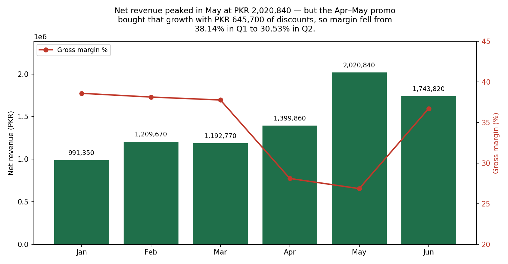

# Mini #25 — Data Storytelling & Executive Summary Pack

**Status:** built, verified locally — publish pending

**SAMPLE / DEMO data only.** Fictional store, fictional sales,
fictional numbers. Never claimed as real client work.

**Why this pack:** Decision-Making runs ~29–40% plus Stakeholder
Management ~26% across all three boards in the 24 Nov 2026
market watch, and the master plan calls this skill the "#1
final-round differentiator": one page of numbers plus the
recommendation a manager can act on. Employers do not hire the
analyst who can run the query; they hire the one who can walk
into the room, say what the numbers mean in sixty seconds, and
leave one page behind. This pack is that skill, ten techniques
deep, on one shop with a real story in it: the Apr–May promo
bought a 52.18% revenue rise with discounts, and margin fell
7.61 points. Every technique ships as its own `.sql` file with
the problem stated in its header comment, plus the CSV of its
exact expected output — so anyone can run the query and check
their answer against the file. The eighth technique is the
one-page summary itself, rendered as Markdown and PDF.

## Business question

"One page, one minute — what happened, what does it mean, and
what should we do?"

## What is inside

| File | What it does |
|---|---|
| `outputs/findings.md` | The teaching write-up: headline numbers + what each technique proves, one common mistake per technique |
| `outputs/summary.json` | Every verified headline number, machine-readable |
| `outputs/test_results.json` | The automated check run: how many checks passed |
| `outputs/executive_summary_one_pager.md` | The one-page summary a manager could actually read |
| `outputs/executive_summary_one_pager.pdf` | The same page as a PDF |
| `outputs/technique_06_monthly_trend.png` | Technique 6 chart — monthly net revenue bars + margin line |
| `outputs/technique_01_headline_number.csv` | Technique 1 output — 1 row, the headline KPI + comparison |
| `outputs/technique_02_three_number_story.csv` | Technique 2 output — 3 rows: context, change, consequence |
| `outputs/technique_03_before_after_framing.csv` | Technique 3 output — 2 rows: Q1 baseline vs Q2 promo |
| `outputs/technique_04_ranking_with_cutoff.csv` | Technique 4 output — 7 rows: top 5 products + rest + total |
| `outputs/technique_05_honest_caveat.csv` | Technique 5 output — 2 rows: revenue beside margin |
| `outputs/technique_06_one_chart_one_message.csv` | Technique 6 output — 6 rows: monthly trend + MoM change |
| `outputs/technique_07_recommendation_sentence.csv` | Technique 7 output — 3 rows: finding, so what, do this |
| `outputs/technique_08_executive_summary.csv` | Technique 8 output — 6 rows: the one-pager, structured |
| `outputs/technique_09_what_not_to_say.csv` | Technique 9 output — 3 rows: misleading framing + correction |
| `outputs/technique_10_sixty_second_brief.csv` | Technique 10 output — 8 rows: the spoken script |
| `sql/t01_headline_number.sql` | Technique 1 — one KPI, stated with its comparison |
| `sql/t02_three_number_story.sql` | Technique 2 — context → change → consequence |
| `sql/t03_before_after_framing.sql` | Technique 3 — before/after with an honest baseline |
| `sql/t04_ranking_with_cutoff.sql` | Technique 4 — ranking with a cut-off + "the rest" |
| `sql/t05_honest_caveat.sql` | Technique 5 — the number that looks good but isn't |
| `sql/t06_one_chart_one_message.sql` | Technique 6 — monthly trend, one takeaway |
| `sql/t07_recommendation_sentence.sql` | Technique 7 — finding → so what → do this |
| `sql/t08_executive_summary.sql` | Technique 8 — the one-page summary, structured |
| `sql/t09_what_not_to_say.sql` | Technique 9 — 3 misleading framings, each corrected |
| `sql/t10_sixty_second_brief.sql` | Technique 10 — the 60-second verbal brief |
| `data/schema.sql` | Clean typed schema — 4 tables, real keys |
| `data/raw/products_SAMPLE.csv` | 9 products, catalogue price + unit cost |
| `data/raw/customers_SAMPLE.csv` | 60 fictional customers, 12 cities |
| `data/raw/orders_SAMPLE.csv` | 550 orders, Jan–Jun 2026, with discount_pct |
| `data/raw/order_items_SAMPLE.csv` | 1,023 order lines |
| `data/demo.db` | SQLite database, rebuilt by `src/build.py` (not uploaded to GitHub) |
| `data/README.md` | Data dictionary + the planted story + totals |
| `src/generate_data.py` | Regenerates all SAMPLE CSVs (fixed seed 20261125) |
| `src/build.py` | Builds the DB, runs all 10 queries, draws the chart, renders the one-pager (MD + PDF) + summary.json |
| `src/checks.py` | Checks as code — every number re-derived from the raw CSVs |
| `src/run_tests.py` | Test runner — runs checks.py, prints PASS/FAIL |
| `requirements.txt` | matplotlib + reportlab |

## Key numbers (real numbers, recomputed from the raw CSVs)

| KPI | Value |
|---|---|
| Orders / lines / units | 550 / 1,023 / 1,523 (Jan–Jun 2026) |
| Gross revenue | PKR 9,331,200 |
| Discounts given away | PKR 772,890 (8.28% of gross) |
| Net revenue | PKR 8,558,310 |
| Gross profit / margin | PKR 2,870,810 / 33.54% |
| Q1 net revenue / margin | PKR 3,393,790 / 38.14% (205 orders) |
| Q2 net revenue / margin | PKR 5,164,520 / 30.53% (345 orders) |
| Headline change | Net revenue +52.18%, profit only +21.80% |
| Margin change | −7.61 points (38.14% → 30.53%) |
| Monthly net revenue | Jan 991,350 · Feb 1,209,670 · Mar 1,192,770 · Apr 1,399,860 · May 2,020,840 · Jun 1,743,820 |
| Month-on-month net change | Feb +22.02% · Mar −1.40% · Apr +17.36% · May +44.36% · Jun −13.71% |
| Discount share of gross | Q1 1.53% (PKR 52,710) · Q2 12.24% (PKR 720,180) · overall 8.28% |
| Peak month | May PKR 2,020,840 (+44.36% on April, 23.61% of the half) |
| Lowest month | Jan PKR 991,350 |
| Promo discount bill | Apr–May PKR 645,700 (Apr 261,540 · May 384,160) |
| Lowest monthly margin | May 26.86% |
| Revenue by category | Electronics PKR 3,474,800 (40.60%) · Furniture PKR 3,164,160 (36.97%) · Kitchen PKR 1,678,390 (19.61%) · Stationery PKR 240,960 (2.82%) |
| Revenue by channel | Online PKR 3,520,350 (41.13%, 224 orders) · Phone PKR 2,627,200 (30.70%, 164) · In-Store PKR 2,410,760 (28.17%, 162) |
| Top product | Office Chair PKR 2,430,000 (28.39%) |
| Top 5 / rest | PKR 6,648,060 (77.68%) / PKR 1,910,250 (22.32%) |
| Average order value | PKR 15,561 overall · PKR 16,753 full-price · PKR 13,772 discounted |
| The 60-second brief | 8 lines, 125 words, ~57 seconds |
| Checks | see `python3 src/checks.py` |

## The 10 techniques

| # | Technique | SQL | What it answers |
|---|---|---|---|
| 1 | The headline number | `sql/t01_*.sql` | One KPI — how much, compared with what? |
| 2 | The 3-number story | `sql/t02_*.sql` | Context → change → consequence — was it good news? |
| 3 | Before/after framing | `sql/t03_*.sql` | Same metric, two periods — is the baseline honest? |
| 4 | Ranking with a cut-off | `sql/t04_*.sql` | Top N — and what is the rest worth? |
| 5 | The honest caveat | `sql/t05_*.sql` | The number looks good — what does it cost? |
| 6 | One chart, one message | `sql/t06_*.sql` | Monthly trend — what is the single takeaway? |
| 7 | The recommendation sentence | `sql/t07_*.sql` | Finding → so what → do this, with the number |
| 8 | The one-page executive summary | `sql/t08_*.sql` | Headline, 3 findings, 1 recommendation, 1 risk |
| 9 | What NOT to say | `sql/t09_*.sql` | Three misleading framings, each corrected |
| 10 | The 60-second verbal brief | `sql/t10_*.sql` | Say it out loud, from verified numbers only |

## What the pack teaches

1. **A headline is a number plus its comparison.** "PKR
   5,164,520" is trivia; "up 52.18% on Q1 (PKR 3,393,790)" is a
   headline. Never quote a change without naming the base, and
   never invent a base you do not have — there is no 2025 here,
   so the comparison is Q1.
2. **The third number decides whether the change was good
   news.** Revenue +52.18% with profit +21.80% is a different
   story from revenue +52.18% alone. Context → change →
   consequence, in that order, every time.
3. **A before/after is only honest if the baseline is stated.**
   Q2 is not like-for-like with Q1 — the promo changed the mix.
   Say so in the table, not in a footnote.
4. **A ranking without its tail is cherry-picking.** Top 5 plus
   "the rest" plus a TOTAL that sums to 100% — the reader must
   be able to see what you left out and what it is worth.
5. **A good number without its caveat is a half-truth.** Put the
   margin in the same table as the revenue. The caveat is a
   technique, not an apology.
6. **One chart, one message.** If the chart needs two sentences,
   it needs two charts. The takeaway is the title, and it is
   stored as checkable text, not just pixels.
7. **A recommendation is finding → so what → do this, with the
   number that justifies the action.** "Repeat the promo only
   with a 35% margin floor" is an action; the 7.61 points of
   margin lost is why. An action with no number behind it is an
   opinion.
8. **A misleading framing uses true numbers.** The cherry-picked
   month, the percent without a base, the average hiding a
   split — none of them invents a figure. The defence is not
   "check the numbers" (they check out) but "state the base,
   the period, and the split".

## Verified numbers

| KPI | Value |
|---|---|
| Net revenue | PKR 8,558,310 |
| Headline | Q2 PKR 5,164,520, +52.18% on Q1 |
| Margin | Q1 38.14% → Q2 30.53% (−7.61 pts) |
| Peak / lowest month | May PKR 2,020,840 / Jan PKR 991,350 |
| Top / weakest category | Electronics PKR 3,474,800 / Stationery PKR 240,960 (2.82%) |
| Top / weakest channel | Online PKR 3,520,350 (41.13%) / In-Store PKR 2,410,760 |
| AOV split | PKR 16,753 full-price vs PKR 13,772 discounted |
| Brief | 125 words, ~57 seconds |
| Checks | see `python3 src/checks.py` |

Verification: `python3 src/checks.py` — every headline number is
recomputed from the raw CSVs with the standard library only (no
pandas) and compared against every output CSV, summary.json,
findings.md, the one-pager (MD + PDF text) and this README;
every query is re-run against a freshly rebuilt database and its
output byte-compared with the shipped CSVs; the chart PNG is
checked to be a real PNG of at least 800×500 px and over 10 KB;
and the generator re-run is byte-compared for determinism (see
`src/checks.py`).

## How to run it

1. Install the dependencies: `pip install -r requirements.txt`
   (matplotlib + reportlab; the checks themselves are standard
   library only).
2. Read `outputs/findings.md` — that is the deliverable, and
   `outputs/executive_summary_one_pager.md` is the page itself.
3. To regenerate the sample data: `python3 src/generate_data.py`.
4. To rebuild the database and re-run all 10 techniques (chart +
   one-pager included): `python3 src/build.py`.
5. To check it: `python3 src/checks.py`.
6. Or run the test suite: `python3 src/run_tests.py`.
7. To run a single technique by hand:
   `sqlite3 data/demo.db < sql/t05_honest_caveat.sql`.
8. To practise on your own data: replace the raw CSVs (same
   columns) and re-run steps 4–6 only — do NOT re-run step 3, it
   regenerates the sample data and would overwrite your files.

## Two traps this pack teaches

- **A good number without its caveat is a half-truth.**
  Revenue +52.18% is true. Margin −7.61 points is also true,
  and it is the same story. The summary that reports one
  without the other has not summarised — it has selected.
- **A percent is not a number until it names its base.** 83.09%
  on PKR 24,840 is PKR 20,640; 44.36% in May is PKR 620,980 on
  April's PKR 1,399,860 — and that May rise cost PKR 384,160
  in discounts. Quote the base with the percent, every time.

## Limits

- **SAMPLE data only.** The store, the sales and the "findings"
  are invented to teach the techniques.
- **The story is planted, not found.** Real business stories are
  messier — the promo effect, the weak category and the strong
  channel would overlap and need untangling. This pack plants
  each thread cleanly so the technique, not the untangling, is
  what gets practised.
- **One shop, six months, no prior year.** Every comparison is
  Q2 vs Q1 or month vs month; the pack never invents a
  prior-year baseline.
- **The recommendation is illustrative, not advice.** A 35%
  margin floor and a 20% discount cap are the pack's worked
  example of a recommendation with a number behind it — a real
  shop would set its floor from its own costs, not from this
  file.
- **The dataset is ~20x the earlier minis.** Same shop, same
  products, same prices — the totals are larger only because
  there are 1,023 lines instead of 52. Per-line economics
  (average order PKR 15,561) stay in the same ballpark.

## Published

Not published yet — built and verified locally 25 Nov 2026.
